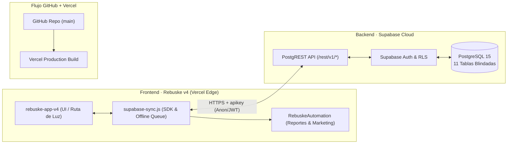

# Rebuske v4 Production (`rebuske-v4-prod`)

> **"Trabajo a tu manera" · "Arregla · Confía · Repite"**  
> Arquitectura Full-Stack de Producción conectada a **Supabase (PostgreSQL + PostgREST v1)**, **GitHub** y **Vercel**.

---

## 1. Visión General de la Arquitectura

Este directorio contiene la configuración de producción de **Rebuske v4** optimizada para despliegue continuo (CI/CD) en **Vercel**, respaldada por **Supabase** (`https://vqvwcbirzezihfzaeziq.supabase.co`) y un motor de automatización de reportes ejecutivos y marketing (`supabase-sync.js`).



---

## 2. Estructura del Proyecto

| Archivo | Propósito Arquitectónico |
| :--- | :--- |
| `vercel.json` | Configuración de Vercel Edge: cabeceras de seguridad (HSTS, CSP/XFO), proxy limpio `/api/supabase/:path*` hacia PostgREST y enrutamiento SPA. |
| `supabase-sync.js` | Módulo Full-Stack sin dependencias que intercepta todas las operaciones de Rebuske v4 (`jobs`, `chat_messages`, `professionals`, `categories`, `wallets`, `disputes`), gestiona cola offline (`localStorage`) y expone el conector de automatización y reportes ejecutivos. |
| `package.json` | Scripts de servidor local (`npm start`), previsualización con Vercel CLI (`npm run dev`), verificación de conexión a Supabase (`npm run db:check`) y despliegue a producción (`npm run deploy:prod`). |
| `README.md` | Documentación técnica de arquitectura, mapeo de base de datos, variables de entorno y flujo de despliegue. |

---

## 3. Conexión a Supabase REST API (`v1`)

- **Project URL:** `https://vqvwcbirzezihfzaeziq.supabase.co`
- **REST Endpoint:** `https://vqvwcbirzezihfzaeziq.supabase.co/rest/v1`
- **Publishable Anon Key:** `sb_publishable_BK1NkxOB_5Ns0R64v-CW3g_g2TEy4Qi`

### Mapeo de Entidades Rebuske v4 ↔ Esquema SQL (`supabase_schema.sql`)

1. **`categories` y `subcategories`**:
   - Sincroniza las **8 categorías oficiales** (`hogar`, `reparaciones`, `vehiculos`, `tecnologia`, `personal`, `eventos`, `transporte`, `profesionales`) y las **37 subcategorías** con rangos de precios de referencia (`ref_min_price`, `ref_max_price`).
2. **`professionals` y `profiles`**:
   - Mapea los perfiles verificados, calificación (`rating`), trabajos completados (`jobs_count`), nivel (`Bronce`, `Plata`, `Oro`), tarifa base (`base_price`) y disponibilidad en tiempo real (`is_available`).
3. **`jobs` y `job_quotes` (Ruta de Luz)**:
   - Sincroniza la creación de solicitudes (`A.publicar`), las 3 propuestas comparables (`public.job_quotes`), la selección de profesional (`A.elegir`), el recálculo de adicionales (`A.qty`) y el avance de estados de la **Ruta de Luz** (`publicada` → `cotizada` → `asignada` → `en_camino` → `llego` → `en_proceso` → `completado`).
4. **`chat_messages` (Chat con Escudo Anti-Fraude)**:
   - Persiste cada mensaje enviado entre cliente y profesional y activa automáticamente la bandera `is_warning = true` cuando la expresión regular `/\d[\d \-]{6,}\d/` detecta intentos de evasión o envío de teléfonos.
5. **`wallets` y `wallet_ledger` (Pago Protegido y Comisión 7% / 6% Oro)**:
   - Gestiona el saldo retenido en custodia (`balance_pending`), la liberación de fondos (`balance_available`) descontando el **7% de comisión Rebuske** (o **6%** para nivel **Oro**), el registro contable en `wallet_ledger` y el ciclo de retiros cada 4 días (`A.retiro`).
6. **`disputes` (Garantía Escrita de 2 Días)**:
   - Congela el pago en custodia y abre un ticket formal en `public.disputes` con estado `'En revisión'` cuando el cliente reporta una novedad desde la Ruta de Luz (`A.disputa`).

---

## 4. Conector de Automatización para Reportes y Marketing

El módulo `supabase-sync.js` expone globalmente `window.RebuskeAutomation` y `window.RebuskeSupabase`:

```html
<!-- Integración en index.html / rebuske-app-v4.html justo antes de </body> -->
<script src="/supabase-sync.js"></script>
```

### Comandos Ejecutivos en Consola / Webhooks

- **Generar Reporte Ejecutivo (GMV, Revenue 7%, Tasa de Disputas, Mapa de Calor por Zona):**
  ```js
  const reporte = window.RebuskeAutomation.generateExecutiveReport();
  console.table(reporte.kpis);
  ```
- **Exportar Libro Mayor / Trabajos a CSV:**
  ```js
  const csv = window.RebuskeAutomation.exportReportCSV();
  ```
- **Obtener Segmentos de Marketing (Campañas "REPITE", Carritos en Escrow y Ascenso a Nivel Oro):**
  ```js
  const segmentos = window.RebuskeAutomation.getMarketingSegments();
  ```
- **Conectar Webhook Externo (n8n / Make / Zapier / Supabase Edge Functions):**
  ```js
  window.RebuskeAutomation.configureWebhook('https://tu-webhook.n8n.cloud/webhook/rebuske-v4');
  ```

---

## 5. Despliegue en GitHub y Vercel

1. **Verificar conexión con Supabase:**
   ```bash
   npm run db:check
   ```
2. **Subir a GitHub:**
   ```bash
   git init
   git add .
   git commit -m "feat(prod): arquitectura Rebuske v4 conectada a Supabase REST API y Vercel"
   git branch -M main
   git remote add origin https://github.com/rebuske/rebuske-v4-prod.git
   git push -u origin main
   ```
3. **Desplegar en Vercel:**
   ```bash
   npm run deploy:prod
   ```
