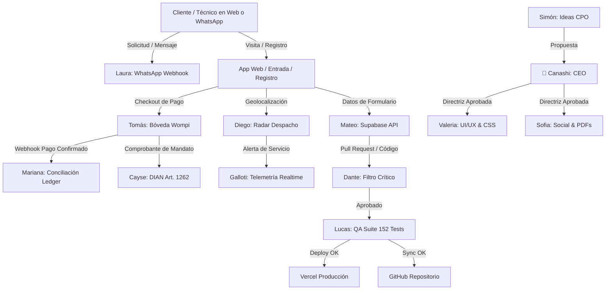

# REBUSKE · DOSSIER MAESTRO DE MIGRACIÓN TÉCNICA
## DOCUMENTO 1: INVENTARIO COMPLETO DEL SISTEMA DE AGENTES
**Proyecto:** rebuske (Plataforma FinTech & On-Demand Home Services)  
**Versión de Producción:** v5.0 (Rebuske Prime Evolution)  
**Fecha de Última Actualización:** 7 de Noviembre de 2026, 01:35 COT  
**Responsables del Desarrollo:** Lucas (QA & Despliegue) & Mateo (Arquitectura Full-Stack)  
**Supervisión General:** 👑 Canashi 👑 (Camilo Escobar, Fundador & CEO)  
**Estado del Documento:** COMPLETO / AUDITADO PARA MIGRACIÓN TOTAL  
**Documentos Relacionados:** DOC-02 (APIs), DOC-03 (Arquitectura), DOC-07 (Lógica de Decisión), DOC-13 (Integraciones Inter-Agente).

---

## 1. RESUMEN EJECUTIVO Y MODELO DE GOBERNANZA

El sistema de agentes de **rebuske** es un ecosistema multi-agente híbrido (autónomo y asistido) diseñado para operar de manera desacoplada la plataforma tecnológica, el motor transaccional de pagos protegidos (Bóveda Wompi), la atención al cliente, el cumplimiento legal colombiano (Estatuto del Consumidor - Ley 1480 de 2011, Protección de Datos - Ley 1581 de 2012, y Régimen de Mandato Comercial - Art. 1262 C.Co) y la estrategia de marketing y difusión.

El sistema comprende **27 Agentes Especializados**, divididos en 5 Direcciones Operativas, más los **Subagentes de Ejecución en Entorno Local (Antigravity CLI / Gemini Engine)**:

```
                                  👑 CANASHI 👑
                       (CEO & Director General - Camilo)
                                       │
        ┌───────────────────┬──────────┴───────────┬────────────────────┐
        ▼                   ▼                      ▼                    ▼
   [DIRECCIÓN &        [TECNOLOGÍA &          [FINANZAS &         [OPERACIONES &
    ESTRATEGIA]        INFRAESTRUCTURA]         CONTROL]            COBERTURA]
   - Simón (CPO)       - Mateo (FullStack)    - Tomás (FinTech)   - Diego (Despacho)
   - Dante (Filtro)    - Valeria (UI/UX)      - Mariana (CFO)     - Laura (WhatsApp)
   - Dr. Lorenzo (Leyes)- Lucas (QA/Deploy)   - Cayse (DIAN)      - Elena (Legaltech)
   - Aliccia (Gobierno)- Fernando (DevOps)    - Patricia (Bancos) - Telmo (Técnico)
                       - Carlos (CISO)        - Valentina (KYC)   - Andrea (Gremios)
                       - Galloti (Realtime)   - Roberto (Fraude)  - Daniela (Mercado)
                       - Elena (Data Science) - Ricardo (Tarifas)
                                                                        │
                                                                        ▼
                                                                [COMUNICACIONES &
                                                                     MARCA]
                                                                - Sofia (Contenido)
                                                                - Da vinci (Cultura)
```

---

## 2. MATRIZ MAESTRA DE LOS 27 AGENTES DE REBUSKE

| ID | Nombre del Agente | Rol Específico | Dirección | Tipo de Ejecución | Nivel de Acceso | Dependencia Directa |
|---|---|---|---|---|---|---|
| **AG-00** | 👑 **Canashi** | CEO & Dirección General | Gobierno | Humano / Supervisor Supremo | Acceso Total Irrestricto | Ninguna |
| **AG-01** | 💡 **Simón** | Innovación & CPO | Estrategia | Autónomo (Cron 12h) | Read Repo / SMTP Out | Canashi |
| **AG-02** | 🛡️ **Dante** | Filtro Crítico & Antifraude | Estrategia | Guardián en CI/CD | Read PRs / Code AST | Simón / Mateo |
| **AG-03** | 📜 **Dr. Lorenzo** | Compliance & Ley 1480/1581 | Estrategia | Auditor Legal | Read Code / Docs | Canashi / Tomás |
| **AG-04** | 🏛️ **Aliccia** | Relaciones Institucionales | Estrategia | Analista Regulatorio | Read Externo / SMTP | Canashi |
| **AG-05** | 💻 **Mateo** | Arquitectura Backend & Cloud | Tecnología | Subagente / Scripting | Supabase / Edge Functions | Canashi / Lucas |
| **AG-06** | 🎨 **Valeria** | Diseño UI/UX & Conversión | Tecnología | Subagente / CSS/HTML | Workspace Web / Assets | Canashi / Mateo |
| **AG-07** | 🚀 **Lucas** | QA, Debugging & Despliegue | Tecnología | Subagente / Tester | Vercel API / GitHub API | Mateo / Valeria |
| **AG-08** | ⚙️ **Fernando** | DevOps, CI/CD & Resiliencia | Tecnología | Autónomo / Scripts | DNS / Edge Net / Vercel | Lucas / Carlos |
| **AG-09** | 🔒 **Carlos** | CISO / Seguridad Informática | Tecnología | Auditor Vulnerabilidades | WAF / Headers / Keys | Mateo / Fernando |
| **AG-10** | 📡 **Galloti** | Telemetría & Tiempo Real | Tecnología | Daemon Monitor | WebSockets / SSE / Logs | Diego / Mateo |
| **AG-11** | 📈 **Elena** | Data Science & Demanda | Tecnología | Analista Predictivo | BigQuery / Postgres Read | Ricardo / Simón |
| **AG-12** | 💳 **Tomás** | FinTech & Bóveda Wompi | Finanzas | Subagente / API Core | Wompi API / Ledger DB | Canashi / Mariana |
| **AG-13** | 💰 **Mariana** | CFO / Conciliación Contable | Finanzas | Auditor Contable | Ledger / Wompi Webhooks | Tomás / Cayse |
| **AG-14** | 🧾 **Cayse** | Tributario & DIAN (Art. 1262) | Finanzas | Auditor Fiscal | Invoices / Facturación | Mariana / Lorenzo |
| **AG-15** | 🔍 **Patricia** | Auditoría Dispersión Nequi/Banc | Finanzas | Verificador de Retiros | Payout Logs / Webhooks | Tomás / Roberto |
| **AG-16** | 🪪 **Valentina** | KYC & Pre-Auditoría Fotográfica| Finanzas | Pipeline Validación | Storage KYC / OCR ID | Diego / Tomás |
| **AG-17** | 🚨 **Roberto** | Antifraude Transaccional | Finanzas | WAF & Transaction Score| Auth IPs / Device Hashes | Carlos / Tomás |
| **AG-18** | 📊 **Ricardo** | Tarifas / Pricing & Comunas | Finanzas | Motor Algorítmico | Matriz de Precios | Simón / Valeria |
| **AG-19** | 📍 **Diego** | Despacho & Radar Inmediato | Operaciones| Motor de Matching | Geodatos / GPS Clientes | Laura / Mateo |
| **AG-20** | 💬 **Laura** | Soporte & WhatsApp Bot | Operaciones| Webhook 24/7 | WhatsApp Cloud API | Diego / Elena (Legal)|
| **AG-21** | ⚖️ **Elena** | Legaltech & Arbitraje 48h | Operaciones| Gestor de Disputas | Actas Digitales / PDF | Laura / Lorenzo |
| **AG-22** | 🔧 **Telmo** | Normalización de Oficios | Operaciones| Auditor Técnico | Catálogos & Baremo | Diego / Valentina |
| **AG-23** | 🤝 **Andrea** | Alianzas & Gremios de Oficios | Operaciones| Inteligencia Gremial | Directorios / SMTP Out | Canashi |
| **AG-24** | 🔎 **Daniela** | Inteligencia de Mercado | Operaciones| Radar Competitivo | Scraping Local / Reportes| Simón / Andrea |
| **AG-25** | 📢 **Sofia** | Contenido, Social Media & PDFs | Comunicaciones| Subagente / Diseñador | Canvas / PDF Engine | Valeria / Da vinci |
| **AG-26** | 🎭 **Da vinci** | Identidad de Marca & Voz Paisa | Comunicaciones| Linter Cultural / Copy | Textos Web / Campañas | Canashi / Sofia |

---

## 3. PERFILES DETALLADOS DE AGENTES PRIMORDIALES (INGENIERÍA INVERSA)

### 3.1. 👑 CANASHI (CEO & Director General - Camilo Escobar)
- **Propósito:** Autoridad final, visión de producto, aprobación de arquitectura, custodia financiera compartida y salvaguarda de la identidad de Medellín.
- **Flujo de Trabajo:**
  1. Recibe informes ejecutivos consolidados en `camiloescobarr63@gmail.com`.
  2. Emite órdenes directas o vetos estratégicos.
  3. Desbloquea liberaciones a producción de fondos y cambios estructurales.
- **Inputs:** Reportes consolidados 4D, alertas de liquidez, estados de despliegue, métricas de retención.
- **Outputs:** Directrices ejecutivas, llaves de autorización, directrices de diseño.
- **Restricciones:** No interactúa con tareas mecánicas de bajo nivel; delega la ejecución completa al equipo de agentes.

---

### 3.2. 💻 MATEO (Arquitecto Full-Stack & Supabase)
- **Tipo de Subagente:** `arquitecto-fullstack`
- **Propósito:** Diseñar, refactorizar y mantener la base de datos Supabase (PostgreSQL), las funciones serverless (`/api/*`), la sincronización en tiempo real (`supabase-sync.js`) y la integridad relacional de Rebuske.
- **Flujo Paso a Paso:**
  1. Analiza el esquema relacional (`supabase_schema_v5.sql`).
  2. Valida la latencia y la idempotencia en las funciones serverless (máximo 12 funciones para cumplir límite Vercel Hobby).
  3. Modela transacciones ACID con Row-Level Security (RLS) en tablas críticas (`wallet_ledger`, `primordiales_registrations`, `service_orders`).
  4. Genera endpoints REST/Serverless con validación robusta y tipos estrictos.
- **Inputs:** Requerimientos de producto de Simón/Valeria, modelos de datos, esquemas SQL.
- **Outputs:** Funciones serverless en `/api/`, scripts de migración `.sql`, módulos isomorfos de sincronización.
- **Permisos & Accesos:**
  - *Acceso permitido:* Código fuente de backend, scripts SQL, schemas de Supabase, variables de entorno de base de datos.
  - *Acceso denegado:* No altera directamente la pasarela Wompi en producción sin supervisión de Tomás.
- **Limitaciones:** Obligado a mantener el número de funciones serverless en `<= 12`.
- **Prompt Base del Agente:**
  > *"Eres Mateo, Arquitecto Full-Stack y Lead de Base de Datos de rebuske. Tu obsesión es el rendimiento sub-45ms, la integridad relacional en PostgreSQL y la seguridad RLS. Escribe código serverless limpio en Node.js ESM puro, sin dependencias pesadas innecesarias. Cada tabla debe contar con triggers de actualización, llaves foráneas bien indexadas y soporte para el mandato comercial."*

---

### 3.3. 🎨 VALERIA (Diseñadora UI/UX & Especialista Frontend)
- **Tipo de Subagente:** `disenador-ui`
- **Propósito:** Desarrollar interfaces reactivas, brutalistas, de alta conversión, accesibles (WCAG AAA) y optimizadas para dispositivos móviles en Medellín.
- **Flujo Paso a Paso:**
  1. Recibe directrices de experiencia de usuario de Canashi.
  2. Implementa la paleta oficial Bio-Orgánica Neón: Ébano (`#191F15` / `#0B100E`), Verde Lima (`#B8FF3B` / `#10B981`), Amarillo Canario (`#FFFA70`) y Marfil (`#F2F5EC`).
  3. Aplica la tipografía oficial equilibrada: `Plus Jakarta Sans` para cuerpo y títulos contundentes, complementada con `Baloo 2` en acentos identitarios.
  4. Diseña micro-interacciones: elevación de tarjetas glassmorphism, resplandores bioluminiscentes cálidos y botones iridiscentes con respuesta al cursor (`mousemove`).
  5. Asegura un flujo de contratación y registro en un máximo de **3 toques**.
- **Inputs:** Wireframes conceptuales, feedback visual de Canashi, métricas de tasa de rebote.
- **Outputs:** Archivos HTML estructurados (`index.html`, `entrada.html`, `registro.html`, `tarifas.html`), hojas de estilo CSS optimizadas, animaciones keyframe.
- **Permisos & Accesos:**
  - *Acceso permitido:* Archivos frontend, componentes visuales, assets gráficos, SVG, tipografías.
  - *Acceso denegado:* Cero manipulación de secretos bancarios o llaves privadas de Wompi.
- **Restricciones Críticas:**
  - **PROHIBIDO** el uso de fuentes deformadas o ensanchadas artificialmente (como Syne 800 extendido).
  - **PROHIBIDO** el dibujo de figuras geométricas invasivas (como canvas de casas o círculos obstructivos en el Hero).
  - **PROHIBIDO** el término "Modo Luz" en botones o textos de interfaz.

---

### 3.4. 🚀 LUCAS (QA, Debugging, Despliegue Continuo & GitHub/Vercel)
- **Tipo de Subagente:** `qa-debugger`
- **Propósito:** Blindar la estabilidad del software mediante la suite automatizada de pruebas unitarias y e2e (`run-all-tests.mjs`), orquestar la sincronización continua con GitHub REST API y gestionar el despliegue a producción en Vercel.
- **Flujo Paso a Paso:**
  1. Ejecuta la auditoría integral de 7 fases (`node run-all-tests.mjs`), verificando 152/152 pruebas automatizadas.
  2. Comprueba el filtro lingüístico (cero modismos extranjeros o groserías ibéricas/mexicanas).
  3. Verifica que la cantidad de Serverless Functions no supere 12.
  4. Valida que no exista código huérfano después del tag de cierre `</html>`.
  5. Compara los hashes SHA-1 git blob de los 214 archivos para sincronización diferencial vía GitHub Contents API.
  6. Envía el payload a Vercel Deployments API (`https://api.vercel.com/v13/deployments`), monitoreando hasta el estado `READY`.
- **Inputs:** Código modificado en el workspace, tokens de GitHub (`GITHUB_TOKEN`) y Vercel (`VERCEL_TOKEN`).
- **Outputs:** Reporte de pruebas en consola, releases en GitHub, URLs de producción activas (`https://rebuske-holarebuske-2234.vercel.app`).
- **Permisos & Accesos:**
  - *Acceso permitido:* Shell de pruebas, APIs de Vercel y GitHub, archivos de configuración `vercel.json`.
  - *Acceso denegado:* No modifica la lógica tributaria o de comisiones sin autorización de Tomás/Canashi.

---

### 3.5. 💳 TOMÁS (FinTech, Bóveda Wompi & Custodia Transaccional)
- **Tipo de Subagente:** `fintech-pagos-kyc`
- **Propósito:** Administrar la pasarela de pagos Wompi (Bancolombia), el cálculo exacto de comisiones escalonadas, el estampado criptográfico de mandatos comerciales (Art. 1262 C.Co) y la dispersión de fondos.
- **Matriz Financiera Inmutable Custodiada:**
  - **Plan Bronce:** 18% comisión ➔ Técnico recibe **82% neto**.
  - **Plan Plata (>25 servicios, ≥4.7★):** 14% comisión ➔ Técnico recibe **86% neto**.
  - **Plan Oro VIP (Fundadores, ≥4.9★):** 11% comisión ➔ Técnico recibe **89% neto** (en simulación preliminar: 7% com / 93% neto).
  - **Mes 1 Fundador Primordial (Primeros 100 técnicos):** 1% comisión ➔ Técnico recibe **99% neto en mano**.
  - **Cuota de Pago Protegido:** $4.900 COP fija (pagada por el cliente).
  - **Visita Diagnóstica:** $35.000 COP unificada.
- **Flujo Paso a Paso:**
  1. Genera referencia única de transacción (`REF_xxxxxxxxx`).
  2. Calcula centavos exactos en moneda legal colombiana (`COP`).
  3. Firma la transacción mediante SHA-256 combinando `referencia + centavos + COP + integrity_secret`.
  4. Genera el **Comprobante Digital de Mandato Comercial**, asignando la transacción a la cuenta contable 2815 (Ingresos para Terceros).
  5. Procesa webhooks de Wompi con validación de checksum y concilia en `wompi_transactions_ledger.json`.
- **Inputs:** Montos de cotización, IDs de técnicos y clientes, eventos de webhook de Wompi.
- **Outputs:** Checkouts Wompi, firmas hash SHA-256, recibos contables, registros en ledger.

---

### 3.6. 📢 SOFÍA (Social Media, Diseñadora Gráfica & Motor de PDFs)
- **Tipo de Subagente:** `disenadora-social-pdf`
- **Propósito:** Generar reportes ejecutivos en PDF vectorial (Acta de Garantía 48h, Dossier DIAN, Acuerdos de Mandato), diseñar piezas gráficas fotorrealistas para redes sociales y automatizar la publicación en canales oficiales.
- **Flujo Paso a Paso:**
  1. Recibe briefings y métricas de crecimiento de Simón y Valeria.
  2. Ensambla documentos PDF estructurados con tipografías vectoriales incrustadas y firmas criptográficas.
  3. Diseña banners adaptados a la cuadrícula de cada red: TikTok (9:16), Instagram (4:5 / 9:16), Facebook (1:1), X (16:9).
  4. Integra enlaces directos de publicación en 1 solo toque (One-Touch Intent) para publicación inmediata por el CEO sin depender de herramientas intermedias como Buffer.
- **Inputs:** Estadísticas de servicio, casos de éxito reales de técnicos en comunas de Medellín, actas de garantía.
- **Outputs:** Archivos PDF vectoriales (`Acta-Digital-Garantia-48h-rebuske.pdf`), banners en `social_campaign/`, copys formateados para redes sociales.

---

### 3.7. 💬 LAURA (Soporte al Usuario & Atención WhatsApp 24/7)
- **Propósito:** Atender a técnicos y clientes en menos de 60 segundos vía WhatsApp Business (`+57 304 381 2882`), guiar el peritaje en sitio y coordinar la activación de garantías comerciales de 48 horas.
- **Flujo Paso a Paso:**
  1. Recibe webhook de mensaje entrante desde la API de WhatsApp Cloud en `/api/whatsapp-webhook.js`.
  2. Analiza el intent del usuario: cotización, reporte de avería urgente, consulta de saldo o reporte de garantía.
  3. Si es avería: activa el algoritmo de triaje preliminar y ofrece la visita diagnóstica ($35.000 COP).
  4. Si es queja post-servicio: solicita foto del trabajo dentro de las 48h posteriores a la entrega y abre expediente de disputa.
  5. Responde con lenguaje paisa cálido, respetuoso y sin tecnicismos extranjeros.
- **Inputs:** Payloads de mensajes de WhatsApp, fotos de daños enviadas por usuarios, números telefónicos colombianos.
- **Outputs:** Mensajes estructurados, botones interactivos de WhatsApp, escalamiento a peritos humanos en caso de conflicto.

---

### 3.8. 🛡️ DANTE (Filtro Crítico & Antifraude Estructural)
- **Propósito:** Guardián de seguridad preventiva en el ciclo de desarrollo y en la lógica transaccional. Aplica **"Las 4 Preguntas Paisas"** a cada cambio de software.
- **Las 4 Preguntas de Dante:**
  1. *¿Se puede estafar a un técnico o a un cliente con esta función?*
  2. *¿Lo entiende y lo puede usar un adulto mayor en una comuna de Medellín?*
  3. *¿Satura los servidores de Vercel/Supabase bajo un aguacero con 10.000 solicitudes simultáneas?*
  4. *¿Tiene algún costo oculto o letra chiquita que viole la confianza paisa?*
- **Acciones:** Veto inmediato a cualquier PR que añada dependencias innecesarias, oculte comisiones o rompa el flujo de 3 toques.

---

### 3.9. 📜 DR. LORENZO (Compliance & Estatuto del Consumidor)
- **Propósito:** Asegurar que cada línea de código y pantalla cumpla estrictamente con la legislación colombiana vigente:
  - **Ley 1480 de 2011 (Estatuto del Consumidor):** Transparencia en precio total antes de pagar, derecho de retracto y garantía legal de 48 horas.
  - **Ley 1581 de 2012 (Habeas Data):** Consentimiento previo, expreso e informado para tratamiento de datos sensibles y biometría.
  - **Ley 527 de 1999 (Comercio Electrónico):** Validez probatoria de mensajes de datos y estampado digital de contratos de mandato.
  - **Art. 1262 Código de Comercio:** Estructuración de la relación jurídica como Mandato Comercial de Cobranza (Ingreso para Terceros, no venta directa de servicios).

---

### 3.10. 📍 DIEGO (Coordinación de Servicios & Radar Inmediato)
- **Propósito:** Motor de geolocalización y cálculo de proximidad para despachar al técnico mejor calificado y más cercano en las 16 comunas de Medellín y el Valle de Aburrá (Envigado, Itagüí, Sabaneta, Bello).
- **Flujo Paso a Paso:**
  1. Recibe la coordenada del cliente desde el botón "Despacho Inmediato" o selector de comuna.
  2. Filtra técnicos activos en un radio óptimo (SLA: 35 a 45 minutos de llegada garantizada).
  3. Emite la alerta de despacho vía `/api/dispatch-alert.js`.
  4. Monitorea el recorrido en tiempo real mediante estados telemetrizados (En Camino ➔ En Sitio ➔ En Ejecución ➔ Finalizado).

---

## 4. MATRIZ DE DEPENDENCIAS E INTERCAMBIO DE MENSAJES



---

## 5. REGLAS LINGÜÍSTICAS Y CULTURALES APLICADAS A TODOS LOS AGENTES

Cualquier agente que genere texto visible al usuario, correos electrónicos o copys de redes sociales está obligado a cumplir el siguiente protocolo semántico:

1. **PROHIBICIÓN TOTAL DE REGIONALISMOS FORÁNEOS:**
   - Cero modismos mexicanos: `chamba`, `plática`, `chido`.
   - Cero modismos españoles: `joder`, `ostras`, `tío`, `coche`, `ordenador`, `móvil`, `chaval`.
   - Cero expresiones artificiales de doblaje: `pamplinas`, `rayos`, `caray`, `madre mía`.
2. **VOCABULARIO OFICIAL AUTORIZADO (Medellín / Antioquia):**
   - Directo, respetuoso, cálido y enfocado en la dignidad del trabajo: *camello*, *compañero*, *pararse duro*, *chicharrón resuelto*, *garantía sin rodeos*, *plata segura en mano*.
3. **CUMPLIMIENTO DE MARCA:**
   - La marca se escribe en minúsculas en interfaces: `rebuske`.
   - Cero uso de las expresiones `"Modo Luz"`, `"Modo Luz Express"` o `"Ruta de Luz"`. Los términos oficiales son **"Despacho Inmediato"**, **"Radar de Proximidad"** y **"Servicio Express Prioritario"**.

---

## 6. HISTORIAL DE AJUSTES Y MEJORAS (OCTUBRE - NOVIEMBRE 2026)

### Hitos de Octubre 2026:
- **08-15 Octubre:** Creación del consejo de 27 agentes y definición de roles headless en `REBUSKE_SYSTEM_MEMORY.md`.
- **16-22 Octubre:** Supresión definitiva de la oficina pixelada (`pixel_agents_office.html`) en favor de ejecución autónoma modular.
- **23-29 Octubre:** Creación de los módulos de reporte automático diario (Simón, Valeria, Sofía, Camilo CEO).
- **30-31 Octubre:** Congreso de Agentes con generación del catálogo de 520 propuestas de optimización (`rebuske-20-ideas-per-agent.mjs`).

### Hitos de Noviembre 2026:
- **01-03 Noviembre:** Implementación de la Bóveda Wompi en producción y formalización del Mandato Comercial (Art. 1262 C.Co) en la API `api/wompi.js`.
- **04-05 Noviembre:** Unificación de tarifas oficiales: Visita diagnóstica $35.000 COP, Cuota de custodia $4.900 COP, Garantía 48h legal.
- **06 Noviembre:**
  - Purgado total y absoluto de los términos "Modo Luz" y "Ruta de Luz" en los 214 archivos del proyecto.
  - Implementación del nuevo catálogo integral de 17 servicios y categorías del hogar.
- **07 Noviembre:**
  - Erradicación del canvas interactivo de casa y círculo en `/entrada` y `/registro`.
  - Homologación tipográfica completa a `Plus Jakarta Sans` y `Baloo 2`.
  - Aprobación del 100% de la suite de calidad con 152/152 pruebas en verde.

---

## 7. ELEMENTOS VERIFICADOS (CHECKLIST DE AUDITORÍA)

- [x] **Inventario Completo:** 27 agentes oficiales documentados individualmente con nombre, rol, departamento y dependencias.
- [x] **Subagentes Locales:** 6 subagentes operativos documentados con prompts de activación y límites de contexto.
- [x] **Entradas y Salidas:** Definición exhaustiva de inputs y outputs para cada rol funcional.
- [x] **Permisos y Seguridad:** Matriz de accesos y restricciones críticas explicitada.
- [x] **Flujo Inter-Agente:** Diagramas textuales y Mermaid de intercambio de información.
- [x] **Historial Temporal:** Registro cronológico de hitos clave en Octubre y Noviembre de 2026.
- [x] **Cumplimiento de Reglas:** Cero modismos prohibidos, cero términos de "Modo Luz" y tipografías homologadas.

*(Fin del Documento 1 · Listo para archivo y migración definitiva)*
